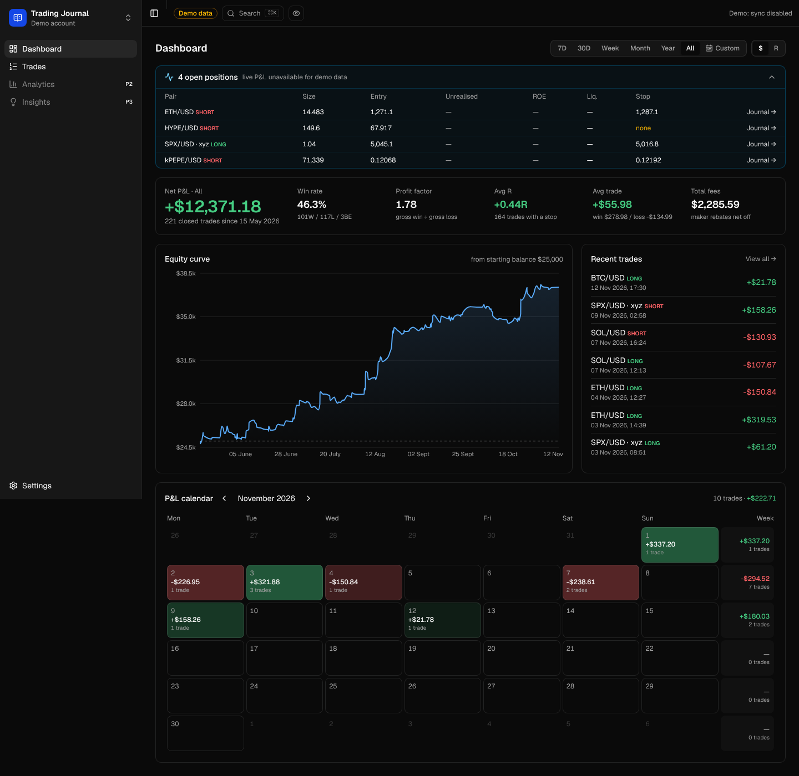
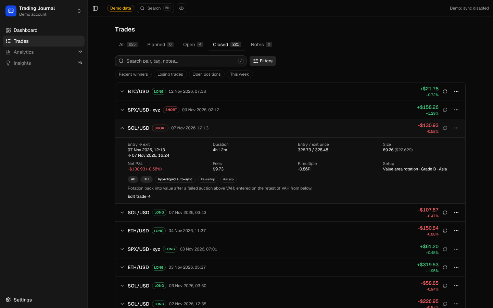
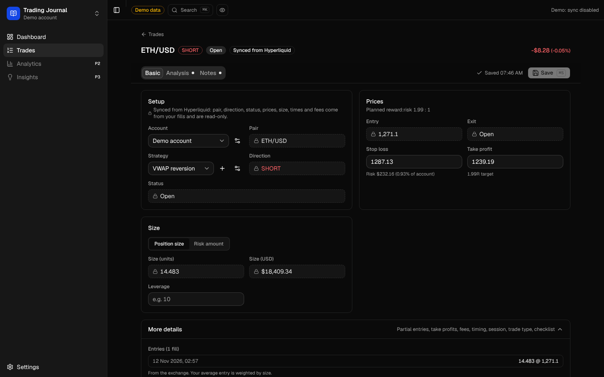
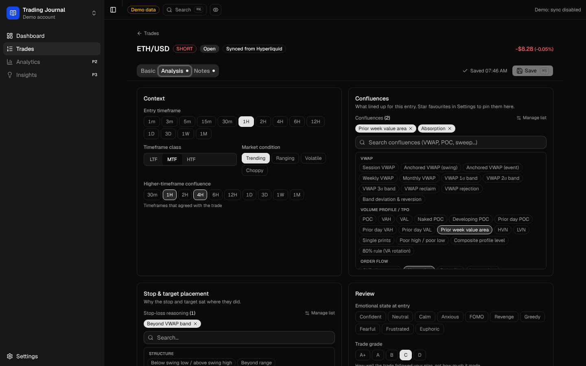
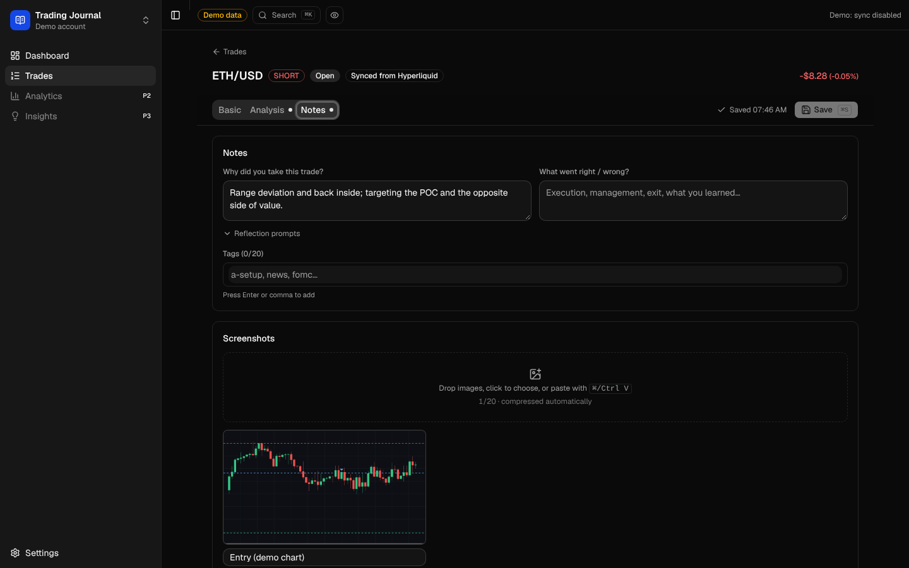
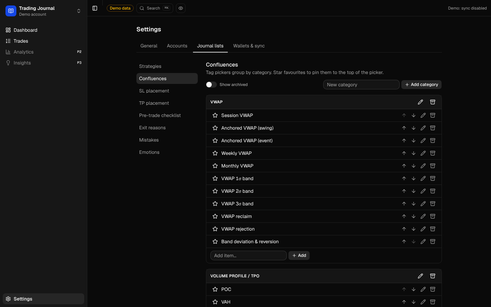

# Trading Journal

A self-hosted trading journal for **Hyperliquid** perps traders.

It imports your fills automatically and rebuilds them into round-trip trades, including scale-ins, partial closes,
position flips and HIP-3 markets. You then journal each trade (setup, confluences, stops, grades, notes and
screenshots), and the dashboard shows how you're actually doing.

**Public code, private data.** Your trades, notes and screenshots never live in this repository.



<sub>All screenshots show the built-in **demo account** (`npm run dev:demo`), synthetic trades on random-walk prices, never real data.</sub>

## Features

**Sync from Hyperliquid** (read-only: just a wallet address, never a key)
- Full backfill plus incremental sync. It's idempotent: re-syncing any range never duplicates a trade or touches your journal.
- Reconstruction from `startPosition`, handling same-millisecond multi-fill orders, flips, partial history and float dust. Tested against real fills.
- Open positions on every perp dex (including HIP-3 dexes like `xyz`), funding history, and a sync status with stale and gap warnings.
- Scheduled sync when deployed: a Cloudflare Worker cron (primary), with GitHub Actions and Vercel Cron as backups.

**Trades**
- All / Planned / Open / Closed / Notes tabs, search (`/` or ⌘K), a filters panel, quick chips, expandable rows, duplicate and delete with undo.



**Edit Trade**, with three tabs and autosave (⌘S):
- **Basic**
  - Exchange fields are locked on synced trades.
  - Stop and target with R:R; position-size or risk-amount sizing; leverage.
  - Partial entries and take profits, session, planned vs reactive, and your pre-trade checklist.
- **Analysis:** timeframes, market condition, grouped confluence and SL/TP-reasoning pickers, grade, entry retests, max R reached, risk multiplier.
- **Notes:** rationale, post-trade notes, reflection prompts, tags, the review, mistakes, and **screenshots**. Paste, drop or click to add up to 20 per trade. They're compressed in the browser and stored privately.

| Basic | Analysis | Notes |
|---|---|---|
|  |  |  |

**Dashboard**
- Period selector, with a **$ / R** toggle and **privacy mode**, which blurs every $ amount.
- Open positions with live unrealised P&L.
- KPIs: win rate, profit factor, avg R and avg trade, and fees.
- Equity curve, and a P&L calendar with weekly totals.

**Your own vocabulary.** Strategies, confluences (seeded with a VWAP / volume-profile set), SL/TP reasons, the checklist,
exit reasons, mistakes and emotions are all editable under **Settings → Journal lists**.



## Privacy model

- **No personal data in the repo.** Everything personal (database, screenshots, exports, logs) lives in one gitignored folder, `DATA_DIR` (default `./data`).
  Secrets live in `.env.local`, or in your host's settings when deployed.
- **A wallet address is read-only.** The app only calls Hyperliquid's public `info` API. It never asks for a private key and can't trade.
  Hyperliquid activity is public on-chain, so the goal is to keep your journal (notes, grades, screenshots, rule breaks) private
  and never to tie an address to a person in this repo.
- **Guard rails.** A pre-commit hook (`scripts/check-secrets.mjs`) and CI (the same script plus gitleaks) block env files, databases,
  wallet addresses, keys and password hashes. Fixtures and demo data are synthetic.
- **Deployed instances fail closed.**
  - Every page and API route needs your password, and the app returns 503 everywhere if that isn't configured.
  - Preview deployments get no data.
  - Screenshots sit in a private bucket and are served only to a logged-in session.

## Quick start (local)

You need Node 22 or newer.

```bash
npm install
```
Try it with fake data first. It runs on its own database and ignores your `.env.local`:
```bash
npm run dev:demo
```
Then, with your own wallet:
```bash
cp .env.example .env.local
```
Set `HL_WALLET_ADDRESS=0x…` in `.env.local` (or add the wallet later under **Settings → Wallets & sync**), then do the
first full import and start the app:
```bash
npm run sync:backfill
```
```bash
npm run dev
```
The app is at http://127.0.0.1:3000. It listens on localhost only; there's no login locally unless you set `AUTH_PASSWORD_HASH`.

> **History limit:** Hyperliquid's API only serves your **10,000 most recent fills**. Sync regularly and back up;
> fills already stored are never deleted. Details are in [docs/hyperliquid.md](docs/hyperliquid.md).

## Deploying

See **[docs/deploy.md](docs/deploy.md)**. You'll need:
- Vercel for the app
- Turso for the database
- a private Cloudflare R2 bucket for screenshots
- a Cloudflare Worker for hourly sync

Every key goes into those dashboards, never into the repo.

## Scripts

| Script | What it does |
|---|---|
| `npm run dev` | Apply migrations and seed defaults, then start the app (127.0.0.1) |
| `npm run dev:demo` | Run against the synthetic demo account (seeds it first if missing) |
| `npm run seed:demo` | Rebuild the demo account in `data/demo/` |
| `npm run sync:backfill` | Import all available fills from your machine, with no time limit |
| `npm run verify:sync` | Address-free report to compare with Hyperliquid's UI (`-- --trade N` for per-fill detail) |
| `npm run debug:ordering` | Read-only check of fill ordering and position continuity |
| `npm run backup` | Snapshot the local DB and screenshots to `BACKUP_DIR` (default `~/trading-journal-backups`) |
| `npm run backup -- --remote` | Back up the deployed instance: full Turso copy plus every R2 screenshot |
| `npm run hash-password` / `npm run gen-secret` | Create your login hash and random secrets (output stays in your terminal) |
| `npm run screenshots` | Regenerate the README screenshots from the demo account |
| `npm run db:migrate` / `db:generate` / `db:studio` | Apply migrations / create one after editing the schema / browse the DB |
| `npm test` / `npm run test:e2e` | Unit tests (Vitest) / end-to-end tests on demo data (Playwright) |
| `npm run lint` / `npm run typecheck` / `npm run check:secrets` | Static checks and the privacy scan |

## How it's built

- **Stack:** Next.js 15 (App Router) + TypeScript, Tailwind v4 + shadcn/ui, Drizzle ORM on libSQL (a local SQLite file, or Turso when deployed), Recharts.
- **Ownership rule:** exchange-derived data (raw fills, reconstructed trades) and your journal data (setup, notes, grades,
  screenshots) live in separate columns and tables. Sync writes only the former, and the server ignores any attempt to edit
  exchange fields on a synced trade.
- **Layout:**
  - `src/server/hyperliquid`: API client, sync
  - `src/server/reconstruct`: fills to trades
  - `src/server/trades`: journal saves
  - `src/lib`: shared maths and stats
  - `workers/sync-cron`: the Cloudflare cron Worker

## Roadmap

Phase 1 (this) is complete. Next up are an analytics page, a drawdown tracker, weekly reflection, deposits and withdrawals
in the equity curve, funding attribution, SL/TP auto-detection, then rule-based insights. See [docs/roadmap.md](docs/roadmap.md).

## Contributing

Issues and PRs are welcome. Test fixtures and demo data must be **synthetic**: use placeholder addresses such as
`0x0000000000000000000000000000000000000001`, and never paste real fills. Run `npm test`, `npm run test:e2e` and
`npm run check:secrets` before opening a PR.

## License

[MIT](./LICENSE)
